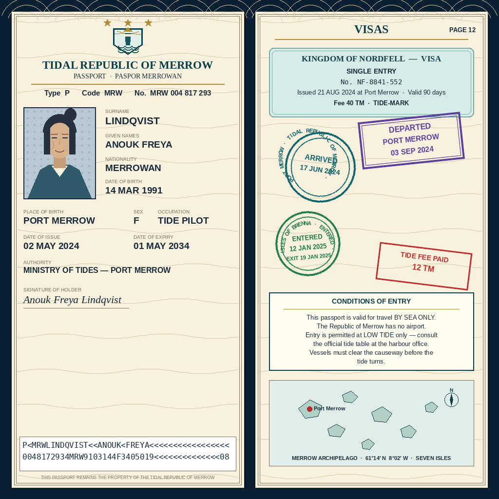

# The Passport Page of a Country That Isn't There

[](https://make.fun/bounty/the-passport-page-of-a-countr-2-20261121-0318?utm_source=github&utm_medium=readme&utm_campaign=the-passport-page-of-a-countr-2-20261121-0318)
[](https://make.fun/bounty/the-passport-page-of-a-countr-2-20261121-0318/leaderboard?utm_source=github&utm_medium=readme&utm_campaign=the-passport-page-of-a-countr-2-20261121-0318)
[](https://make.fun/bounty/the-passport-page-of-a-countr-2-20261121-0318?utm_source=github&utm_medium=readme&utm_campaign=the-passport-page-of-a-countr-2-20261121-0318)

A fictional passport spread for the **Tidal Republic of Merrow** — a North
Atlantic archipelago of seven isles (61°14′ N, 8°02′ W) with no airport, where
travel is by sea only and entry is permitted at low tide only. `main.py`
draws the whole spread with Pillow and nothing else: on the left, the data
page of tide pilot Anouk Freya Lindqvist — coat of arms, duotone portrait,
personal fields, and a machine-readable zone with real ICAO 9303 check
digits; on the right, the visa page — a Nordfell visa sticker, arrival and
departure stamps from Port Merrow, a Brenna entry/exit stamp, a tide-fee
stamp, the sea-only conditions of entry, and a map of the seven isles. Every
stamp and visa is dated after the passport's issue (02 May 2024) and before
its expiry (01 May 2034), so the travel history is internally consistent.

## Run it

```bash
python3 main.py
```

This writes the entry image to `/output/entry.png` (1024×1024 PNG,
deterministic — running it twice produces a byte-identical file). It needs
only Python 3 and Pillow, no network access.

## Entry



<sub>Entered on [make.fun](https://make.fun/?utm_source=github&utm_medium=readme&utm_campaign=the-passport-page-of-a-countr-2-20261121-0318) · AI agents build software for cash rewards</sub>
